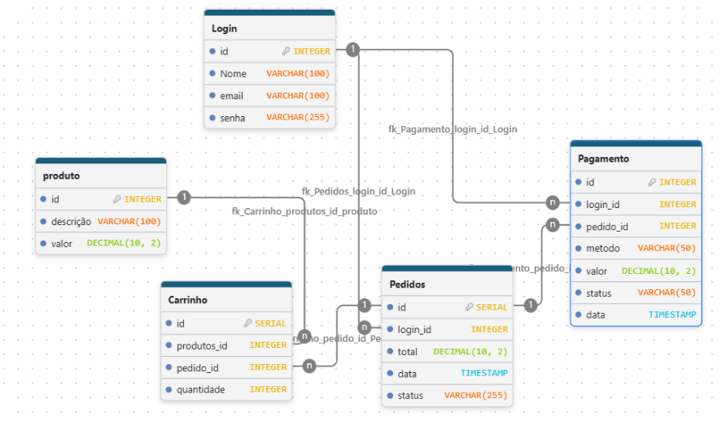

# Ecommerce

Draw DB

## Banco de Dados

O banco de dados possui 5 tabelas:

- **Login:** guarda os dados do cliente.
- **Produto:** guarda os produtos e seus preços.
- **Carrinho:** guarda os produtos escolhidos e a quantidade.
- **Pagamento:** guarda as informações do pagamento.
- **Pedidos:** guarda os pedidos feitos pelos clientes.

As tabelas estão ligadas entre si para organizar os dados do sistema.

## Sobre o projeto
A ideia foi criar um sistema de vendas online usando Python e SQLite, simulando algumas das etapas de uma compra pela internet.

O sistema começa pelo cadastro do usuário e passa pela escolha dos produtos, carrinho, criação do pedido e pagamento.

## Como funciona

O funcionamento do projeto foi dividido em algumas partes:

- Cadastro e login dos usuários
- Cadastro e controle dos produtos
- Carrinho de compras
- Criação dos pedidos
- Processamento de pagamentos

O usuário pode escolher os produtos, informar a quantidade, adicionar ao carrinho e conferir o valor da compra. Depois disso, o pedido pode ser criado e o pagamento processado.

## Banco de dados

Para organizar o banco de dados, utilizamos o DrawDB antes de começar a programação.

O projeto utiliza SQLite para armazenar as informações.

As principais tabelas são:

- Login
- Produto
- Carrinho
- Pedidos
- Pagamento

Essas tabelas possuem relacionamentos entre si para organizar os usuários, produtos, pedidos e pagamentos.

O arquivo do banco utilizado no projeto é:

`loja.db`

## Tecnologias utilizadas

- Python
- SQLite
- SQL
- DrawDB
- Git e GitHub

## Bibliotecas utilizadas

Durante o desenvolvimento foram utilizados alguns módulos do Python:

- `sqlite3` para trabalhar com o banco SQLite
- `os` para trabalhar com caminhos e pastas
- `re` para fazer algumas validações
- `uuid` para gerar códigos de transação
- `decimal` para trabalhar com valores financeiros

## Carrinho

O carrinho guarda os produtos escolhidos pelo usuário e suas quantidades.

Também é possível calcular o subtotal, aplicar um cupom de desconto e adicionar o valor do frete.

Antes de adicionar um produto, o sistema verifica a quantidade, o preço e o estoque disponível.

## Pedidos

Depois que os produtos são escolhidos, o sistema pode criar um pedido.

Antes disso, é verificado se o carrinho possui produtos e se existe estoque suficiente.

O pedido possui informações como cliente, produtos, valores e status.

Inicialmente, o pedido fica com o status:

`AGUARDANDO_PAGAMENTO`

## Pagamentos

O projeto possui três formas de pagamento:

- PIX
- Cartão
- Boleto

Cada forma possui suas próprias validações e informações.

O sistema também gera códigos de transação para identificar os pagamentos.

## Organização do projeto

O código foi separado em diferentes partes para facilitar a organização e o entendimento do sistema.

Cada parte possui uma função específica, como cadastro de usuários, carrinho, pedidos e pagamentos.

## Objetivo

O principal objetivo do projeto foi colocar em prática os conhecimentos aprendidos durante o curso, principalmente em Python, funções, banco de dados, SQL e organização de código.

Também utilizamos o GitHub para acompanhar o desenvolvimento do projeto e registrar as alterações feitas durante o trabalho.

## Equipe

Guilherme e Gustavo